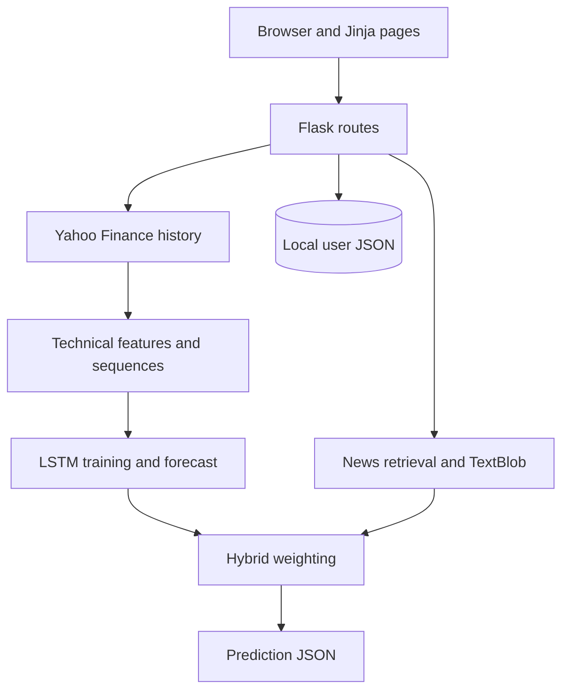

# Stockify

A Flask stock-analysis app combining LSTM price forecasts, news sentiment, watchlists and portfolio tracking.

Stockify brings a symbol’s price history, technical features and experimental forecasts into one browser workflow. Users can explore stock data, compare historical and sentiment-based outputs, and maintain local watchlists and portfolio entries.

The forecasting modules implement standard and bidirectional LSTM options alongside a sentiment path and a weighted hybrid. The source and technical report expose how those outputs are constructed and how to interpret the existing evaluation quantities.

[Run locally](#local-setup) · [Model implementation](#architecture-and-models) · [Technical report](docs/TECHNICAL_REPORT.md) · [Verification scope](docs/VERIFICATION.md)

## Contents

[Problem and implemented features](#problem-and-implemented-features) · [Architecture and models](#architecture-and-models) · [Local setup](#local-setup) · [Evaluation and limitations](#evaluation-and-limitations) · [Attribution](#attribution) · [How a forecast request moves through the application](#how-a-forecast-request-moves-through-the-application)

## Problem and implemented features

The project brings price exploration and multiple forecast approaches into one interface:

- JSON-backed registration/login, watchlist management, and portfolio entries.
- Historical prices and company data fetched through Yahoo Finance using `yfinance`.
- Standard and bidirectional LSTM options with technical price/volume features.
- TextBlob news sentiment with scraping and market-performance fallbacks.
- A heuristic hybrid forecast combining historical and sentiment outputs.
- USD/INR conversion with external rate sources and fallback values.

Flask serves the interface and APIs. Yahoo Finance and news responses supply the market inputs, whose freshness and availability depend on the upstream providers.

## Architecture and models

`app.py` defines browser routes and JSON APIs. Jinja templates render the interface. `models/historical_predictor.py` creates technical features, 30-step input windows, an 80/20 chronological sequence split, and on-request TensorFlow training. `sentiment_analyzer.py` retrieves news and applies TextBlob polarity. `hybrid_predictor.py` weights outputs using heuristic error/confidence quantities. `currency_utils.py` handles currency conversion.

The historical model requests two years of data and uses close, volume, moving averages, RSI, MACD, signal line, volume ratio, momentum, and volatility. There is no versioned training dataset or saved benchmark in this repository.

## Local setup

Use Python 3.11 for the supplied TensorFlow/NumPy pins. From PowerShell:

```powershell
git clone https://github.com/adityahaa/Stockify.git
cd Stockify
py -3.11 -m venv .venv
.venv\Scripts\python.exe -m pip install -r stockify1/requirements.txt
$env:STOCKIFY_SECRET_KEY = (py -3.11 -c "import secrets; print(secrets.token_hex(32))")
cd stockify1
..\.venv\Scripts\python.exe app.py
```

Open http://127.0.0.1:5000. Run from `stockify1` because runtime JSON paths are relative to the working directory. No public deployment is verified. Network access is required for stock/news/currency requests; forecast requests train models and can take time.

## Evaluation and limitations

Read the [technical report](docs/TECHNICAL_REPORT.md) before interpreting model outputs. Existing MAE/RMSE are calculated on scaled targets and then passed through currency conversion; they are not valid price-unit error measurements. The scaler is fit before the train/test split. The displayed confidence and risk scores are heuristics, not calibrated probabilities. No measured accuracy, trading profit, latency improvement, or superiority over a persistence baseline is claimed.

Accounts store plaintext passwords in a local JSON file; the development server enables debugging. Use synthetic credentials and data locally. Public hosting requires authentication/storage hardening, CSRF protection, concurrency review, and a deployment configuration. Forecast dates include calendar days and recursively hold other features fixed.

## Attribution

The original README credits **Kaustubh J.** and links [kaustubhj18/Stockify](https://github.com/kaustubhj18/Stockify). That attribution is retained here; repository ownership does not establish sole authorship. Aditya Hambire maintains this copy. Existing Git history is preserved. No additional rights or third-party data redistribution license is asserted.

Current checks and unresolved prerequisites: [verification record](docs/VERIFICATION.md).

## How a forecast request moves through the application

The practical problem is bringing several views of a stock into the same session. A user signs in, searches a symbol, explores history and requests a forecast. Watchlists and portfolio records preserve the symbols and holdings entered during that workflow. Forecast routes return JSON for the corresponding template to visualize.



### Historical model construction

`HistoricalPredictor.prepare_features` computes 7/21/50-day moving averages, 14-day RSI, MACD and its signal, volume ratio, momentum and volatility. It also constructs Bollinger columns, while the selected model-input list uses eleven features headed by close and volume. Rolling calculations remove the initial incomplete rows. `create_sequences` maps each preceding 30-row window to the next scaled close value.

The standard model contains a 32-unit LSTM, dropout, a 16-unit dense layer and a scalar output. The advanced branch stacks bidirectional 128/64-unit LSTMs followed by a 32-unit LSTM and dense layers. Training uses Adam/MSE, batch size 64, a 5% validation split within training, and early stopping on training loss. Model selection changes computation per request, so response time depends on the selected architecture, retrieved history and host hardware.

### Sentiment and hybrid behavior

`SentimentAnalyzer` first attempts provider news, then other news sources and fallbacks. TextBlob supplies polarity-based signals. `HybridPredictor.combine_predictions` normalizes inverse historical MAE and sentiment confidence into weights, combines the common forecast horizon, and returns the available component directly when the other has no predictions. These rules are inspectable, but their weight scales need a common evaluation protocol before the hybrid's quality can be compared with either component.

### Observable outcome and evaluation boundary

The source implements browser/API paths for exploration, account state, watchlists, portfolio records and three forecast modes. The current review established Python syntax and traced those paths. Runtime training and market-data integration remain to be verified with the environment described above. The technical report explains the existing scaling and error-unit issues so a future evaluation can report interpretable price errors against a previous-close baseline.

### Source navigation

```text
stockify1/
  app.py                    Flask pages, account state and APIs
  requirements.txt          pinned Python dependencies
  models/
    historical_predictor.py features, LSTMs and recursive forecast
    sentiment_analyzer.py   news acquisition and polarity
    hybrid_predictor.py     weighting and heuristic risk output
    currency_utils.py       price conversion
  templates/                Jinja pages for the user workflow
docs/                       evaluation findings and verification scope
```

The next modeling improvement is a fixed chronological benchmark with train-only scaling and inverse-transformed targets. Authentication hardening and consistent currency provenance are the corresponding priorities for a shared deployment.
